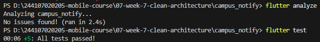

# Jobsheet 07 | Clean Architecture

## Praktikum 1: Audit Layer Project Lama

### 1. Pemetaan File ke Layer

| File | Layer saat ini | Masalah |
| :--- | :--- | :--- |
| `pages/home_page.dart` | presentation | Memanggil Dio langsung / memformat tanggal / parsing JSON di widget |
| `data/api_client.dart` | data | OK bila hanya dipakai repository, bukan widget |
| `providers/auth_provider.dart` | presentation (state) | OK bila hanya memanggil repository/use case |
| `data/auth_repository.dart` | data (+kontrak tercampur) | Interface dan implementasi masih satu kelas |

### 2. Hasil Audit Pelanggaran Kode (Praktikum 1)

* **Widget menyentuh jaringan/database langsung**: `0 hasil` (Bersih)
* **Logika bisnis/formatting di dalam UI**: `0 hasil` (Bersih)
* **Instansiasi manual (DI bocor)**: `1 temuan`
  * File: `lib/providers/auth_provider.dart`
  * Kode: `Provider<AuthRepository>((ref) => AuthRepository());`

 

  

> **Catatan Refactor**: Item temuan pada `auth_provider.dart` ini akan diperbaiki pada Praktikum 2 & 3 agar memenuhi standar Clean Architecture.

### 5. Praktikum 3: Presentation, DI, dan verifikasi
Proses refactoring pada fitur `notes` berhasil diselesaikan sesuai standar **Clean Architecture**. Aplikasi berjalan dengan fungsi yang sama seperti sebelum _refactor_, namun memiliki struktur kode yang jauh lebih rapi, terisolasi, dan siap untuk pengembangan skala besar.

 

### 6. AI Challenge (Clean Architecture Proposal & Verification)

Dokumentasi lengkap usulan arsitektur, trade-off, wiring Riverpod, dan verifikasi teknis tersimpan di direktori `docs/`:

- 📄 [AI Challenge - Prompt](docs/ai-challenge-prompt.md)
- 📄 [AI Challenge - Output Awal AI](docs/ai-challenge-initial-output.md)
- 📄 [AI Verification & Technical Decisions](docs/ai-verification.md)

### Ringkasan Verifikasi Tiga Grep:
1. **Domain Bebas Framework**: `git grep -E "import.*(flutter|dio|sqflite|firebase)" lib/features/*/domain/` &rarr; `0 temuan (Lolos)`.
2. **Entity Bebas Mapping**: `git grep -E "(toJson|fromJson|toMap|fromMap)" lib/features/*/domain/entities/` &rarr; `0 temuan (Lolos)`.
3. **Widget Bebas Instansiasi Manual**: `git grep -E "new [A-Za-z]+Repository|[A-Za-z]+Repository\(" lib/features/*/presentation/pages/` &rarr; `0 temuan (Lolos)`.

---

## Refleksi Pembelajaran

### 1) Mengapa interface repository harus tinggal di domain?
Interface repository seharusnya hidup di `domain` karena ia adalah kontrak bisnis, bukan detail implementasi teknis. Domain mendefinisikan apa yang dibutuhkan aplikasi: misalnya `fetchNotes()` atau `login()`, tanpa menyebutkan database SQLite, Dio, Firebase, atau library apapun. Saat kontrak ada di domain, semua lapisan lain boleh berganti teknologi tanpa mengubah aturan bisnis inti.

Kalau interface dibalik ke `data`, maka domain akan bergantung pada detail infrastruktur. Akibatnya:
- domain tidak lagi "murni" dan lebih sulit diuji
- perubahan teknologi (misalnya SQLite ke API REST) mengharuskan domain ikut berubah
- mock/test menjadi lebih terasa seperti menguji implementasi, bukan perilaku bisnis

Singkatnya, `domain` mendefinisikan kebutuhan; `data` menjawab kebutuhan itu dengan implementasi konkret.

### 2) Kapan use case benar-benar dibutuhkan?
Use case dibutuhkan saat ada logika bisnis atau orkestrasi yang belum bisa dianggap sekadar "pass-through". Contoh yang masuk akal:
- validasi email/password sebelum login
- koordinasi beberapa repository atau service
- aturan domain yang melibatkan banyak langkah dan keputusan
- logika yang dipakai oleh beberapa UI atau beberapa fitur

Kondisi yang tidak memerlukan use case adalah saat sebuah operasi hanya memanggil satu repository dan tidak menambah aturan bisnis apa pun. Dalam kasus seperti itu, notifier atau provider bisa langsung memanggil repository. Kita sering menyebutnya sebagai "pass-through use case" yang menjadi boilerplate saja.

### 3) Kapan repository langsung ke notifier sudah cukup?
Repository langsung ke notifier sudah cukup ketika:
- operasi bersifat sederhana: ambil data, simpan data, hapus data
- tidak ada validasi domain yang kompleks
- tidak ada orkestrasi multi-step
- tidak ada reuse logika di lebih dari satu screen

Untuk app kecil atau tim kecil, pola ini paling pragmatis. Kualitas dan kelincahan lebih penting daripada membangun banyak kelas pembungkus yang hanya mengulang fungsionalitas repository.

### 4) Biaya over-engineering (use case per CRUD satu-baris)
Biaya over-engineering pada tim kecil sangat terasa dalam beberapa hal:
- lebih banyak file dan folder untuk dipelajari
- lebih banyak boilerplate tanpa nilai tambah
- debugging lebih lama karena alur logika menjadi lebih panjang
- keputusan arsitektur ikut membebani eksekusi fitur yang sebenarnya sederhana

Biaya ini sepadan ketika proyek sudah besar, banyak tim, banyak aturan bisnis, atau kebutuhan test/maintenance matangnya tinggi. Untuk CRUD kecil, lebih tepat memilih arsitektur yang cukup, bukan yang paling “bersih” secara teori.

### 5) Bagian usulan AI yang ditolak atau disederhanakan
Saya menolak atau sederhanakan beberapa bagian usulan AI karena terlalu idealistik untuk kebutuhan saat ini:

- `announcement`/`notes` yang dibentuk terlalu rigid dengan banyak subfolder `datasources`, `models`, `repositories`, `providers` per fitur. Untuk proyek kecil, struktur yang padat itu terasa berlebihan jika belum ada kebutuhan nyata terhadap multi-source atau banyak aturan bisnis.
- `Use case` untuk read-only query yang hanya memanggil repository satu kali. Ini cenderung over-engineering, karena tidak menambah kebijakan baru.
- Struktur `feature-first` yang sangat “teoretis” bisa dibuat, tapi untuk app kecil, kita memilih pendekatan yang tetap jelas namun lebih efisien: fitur yang sudah masuk ke `features/*`, tetapi tidak memaksa pembuatan banyak file ekstra bila tidak diperlukan.

Yang saya pertahankan adalah prinsip inti:
- domain tetap murni
- repository di domain sebagai kontrak
- implementasi di data
- provider sebagai wiring DI
- UI tidak membuat repository secara langsung
- Failure dan pesan user-friendly dipisahkan dari raw exception

Itulah garis yang memberi manfaat nyata tanpa membebani tim kecil dengan kompleksitas yang tidak dibutuhkan.

### 6) Kesimpulan
Clean architecture bukan tentang membuat sebanyak mungkin file; itu tentang membatasi perubahan dan menjaga aturan kualitas: domain tidak boleh tahu detail teknis, UI tidak boleh tahu detail data source, dan semua keputusan teknis harus terhubung melalui boundary yang jelas. Untuk tim kecil, kuncinya adalah “cukup jelas, cukup teruji, cukup mudah dirawat” — bukan “mengikuti pola semaksimal mungkin.”
