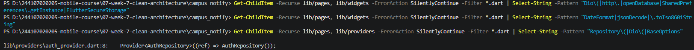

# Jobsheet 07 | Clean Architecture

## Praktikum 1: Audit Layer Project Lama

### 1. Pemetaan File ke Layer

| File | Layer saat ini | Masalah |
| :--- | :--- | :--- |
| `pages/home_page.dart` | presentation | Memanggil Dio langsung / memformat tanggal / parsing JSON di widget |
| `data/api_client.dart` | data | OK bila hanya dipakai repository, bukan widget |
| `providers/auth_provider.dart` | presentation (state) | OK bila hanya memanggil repository/use case |
| `data/auth_repository.dart` | data (+kontrak tercampur) | Interface dan implementasi masih satu kelas |

### 2. Hasil Audit Pelanggaran Kode (Praktikum 1)

* **Widget menyentuh jaringan/database langsung**: `0 hasil` (Bersih)
* **Logika bisnis/formatting di dalam UI**: `0 hasil` (Bersih)
* **Instansiasi manual (DI bocor)**: `1 temuan`
  * File: `lib/providers/auth_provider.dart`
  * Kode: `Provider<AuthRepository>((ref) => AuthRepository());`

 

  

> **Catatan Refactor**: Item temuan pada `auth_provider.dart` ini akan diperbaiki pada Praktikum 2 & 3 agar memenuhi standar Clean Architecture.
